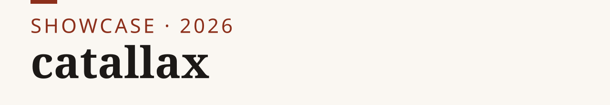
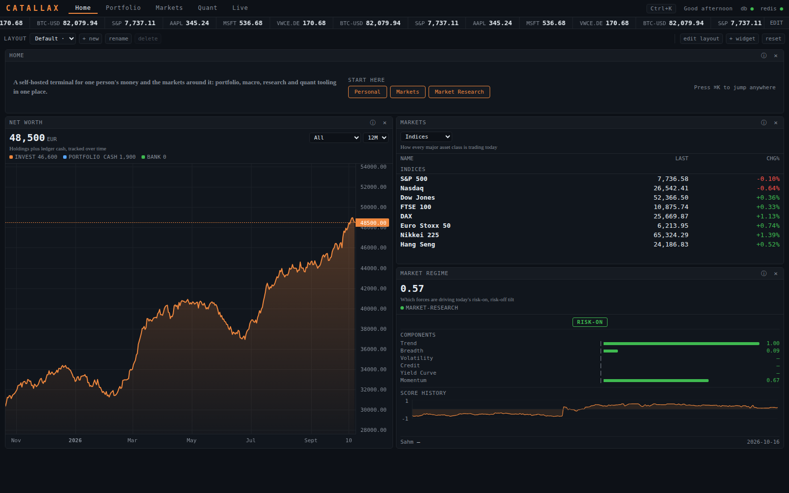
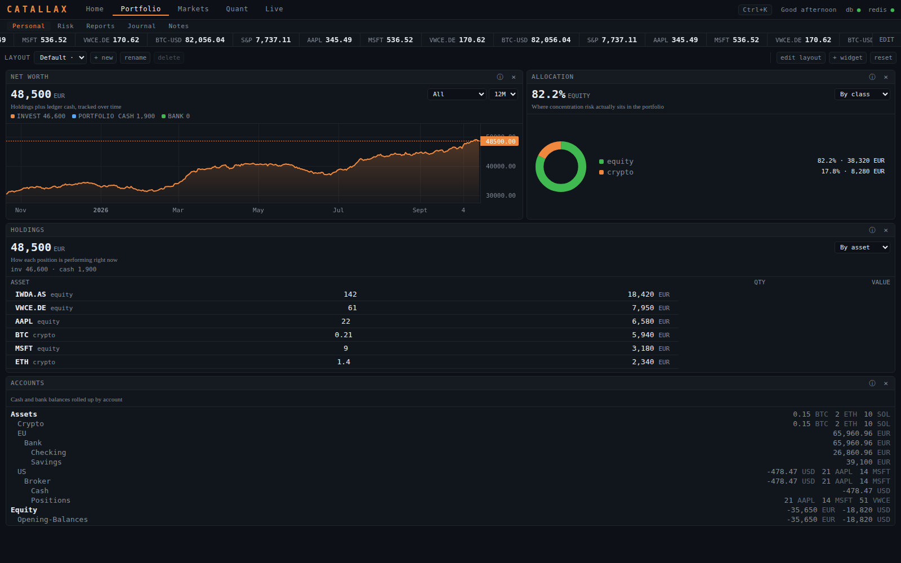
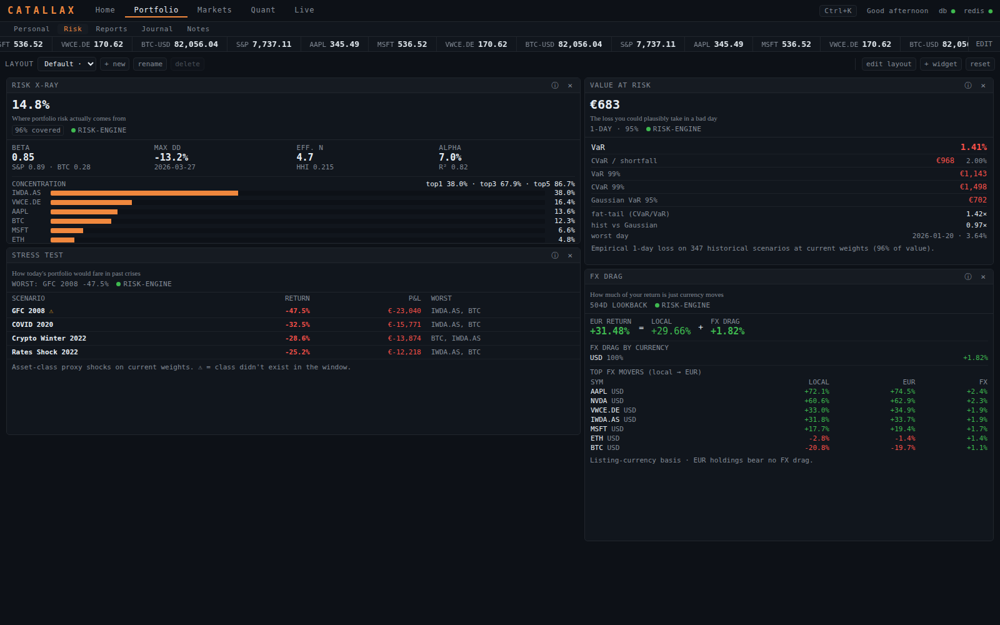
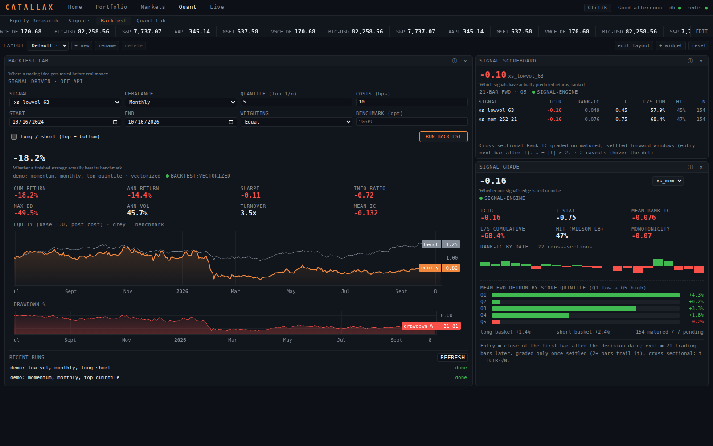

<p><picture><source media="(prefers-color-scheme: dark)" srcset="assets/banner-dark.svg"></picture></p>

**A self-hosted financial terminal for one person's money and the markets around it.**

[Live demo](https://catallax-demo.nikkhosravipour.com) · [Quick start](#quick-start) · [Architecture](#architecture) · [Design decisions](#design-decisions) · [Case study](CASE-STUDY.md) · [Site](https://nikkhosravipour.com)

[](LICENSE) [](LICENSE-docs)

> **Public copy of a private project.** This repository is a public copy of a
> terminal I run for my own finances. Personal data, private infrastructure and the
> AI features have been removed; the portfolio you see is a synthetic persona served
> by a stub exporter. I update it from the private project in batches, and each batch
> goes through the same scrub and privacy scan before it lands here.

**Live demo:** [catallax-demo.nikkhosravipour.com](https://catallax-demo.nikkhosravipour.com)
runs this repository read-only on my homelab. It shows the synthetic persona and a few
sample artifacts; writes are switched off, and market data is served from a cache that
refreshes on a schedule, never fetched per visitor.

Catallax puts net worth, holdings and a Beancount ledger into one dense, keyboard-driven
dashboard, then surrounds them with the market context you would otherwise open six tabs
for: macro and rates, cross-asset research, equity screening, a quant lab and a
paper-trading desk. Everything runs in Docker on your own machine.

It is deliberately dark, dense and Bloomberg-shaped. The assumption is that you want
numbers per square inch, not whitespace.



| | |
|---|---|
|  |  |
| **Portfolio.** Net worth, allocation, holdings and the Beancount ledger. | **Risk.** Concentration, VaR, historical stress tests and FX drag. |



All figures in these screenshots come from the synthetic persona and the sample ledger,
captured from this repository's own stack.

## Quick start

```sh
cp .env.example .env
docker compose up -d --build
```

Open <http://localhost:8090>. The default stack needs no API keys and no paid data. It
starts with a synthetic portfolio (a stub exporter) and a sample ledger, so every panel
has something to show on first run.

`bin/seed-demo.sh` (curl and jq) adds demo signals, journal entries, notes, a watchlist and a few
backtest and lab jobs through the public API. It is idempotent, and the jobs run once the
`backtest` and `lab` profiles are up.

## Finding your way around

Five permanent sections, each with its own URL.

| Section | URL | What's there |
|---|---|---|
| **Home** | `/` | Net worth, market snapshot, regime read. |
| **Portfolio** | `/portfolio` | Holdings, allocation, currency exposure, and a risk lens (vol, beta, drawdown, VaR, FX drag, stress tests). |
| **Markets** | `/markets` | Live board, macro indicators, yield curves and rate spreads, top-down cross-asset research. |
| **Quant** | `/quant` | Equity research and screening, signal scoring, a backtester, an ML factor/model lab. |
| **Live** | `/live` | News and a paper-trading desk. |

Press **⌘K** (Ctrl+K) anywhere to jump to a section, find a widget or look up a symbol.
Every panel has an **ⓘ** in its header explaining what it shows and how to read it.

## Architecture

```
browser ── nginx :8090 ─┬─ react-frontend   (React + Vite + TypeScript)
                        ├─ fastapi-backend  (FastAPI, adapters, risk/quant engines)
                        │     ├─ postgres   (signals, backtests, journal, forecasts)
                        │     ├─ redis      (price cache, job queues)
                        │     └─ stub-exporter  (synthetic portfolio, exporter wire format)
                        ├─ fava             (Beancount UI over data/sample.beancount)
                        └─ report-worker    (weekly report pack, Playwright PDF)
```

Market data sits behind an adapter interface, so adding a source is one class and one
registry line. The portfolio arrives through a bridge that speaks a small exporter
protocol (`/networth`, `/holdings`, `/positions-history`); in the private deployment a real
exporter answers it, here `backend/app/stub_exporter.py` does, and the bridge code is
the same in both. Per-area conventions live in [`skills/`](skills/).

## Optional subsystems

Heavier parts run as separate containers behind compose profiles. Panels that need one
say which profile to start instead of spinning.

| Profile | Command | Adds |
|---|---|---|
| Macro data | `docker compose --profile macro up -d` | OpenBB-backed macro series, yield curves, economic calendar |
| Backtesting | `docker compose --profile backtest up -d` | Off-API backtest worker for signal-driven strategies |
| Quant lab | `docker compose --profile lab up -d` | Factor studies and ML models (XGBoost, torch); a large image |
| Paper trading | `docker compose --profile algo up -d` | Paper-trading engine, order book, strategy runner |

**There is no live-money path anywhere in Catallax.** The trading desk is paper-only by
construction: no broker credentials, no order routing, no wallet signing.

## What this copy cuts, stubs or fakes

| Part | In the private deployment | In this repository |
|---|---|---|
| Portfolio and net worth | Read-only exporter over the LAN | Stub exporter with a synthetic persona |
| Ledger | Personal Beancount files | `data/sample.beancount` |
| AI features (news enrichment, cockpit, LLM reports) | Claude via local credentials | Disabled by default (`LLM_PROVIDER=noop`); the Claude CLI adapter and skills remain but need local credentials |
| Hosting, reverse proxy, sync scripts | Self-hosting setup | Removed |
| Screenshots | — | Captured from this repository's stub stack |

## Tests

```sh
bin/test-backend.sh
```

Runs the backend suite without a `.env`. Last local run: 1006 passed, 55 skipped
(database suites skip when no Postgres is reachable), 0 failed.

## Data sources

Prices come from yfinance and CoinGecko, with a Stooq fallback and a local cache. Several
adapters scrape public pages and send a browser-like User-Agent. Check each source's
terms before you use them beyond personal research.

## Security

Catallax is a LAN-only, single-user app. It speaks plain HTTP and binds to `127.0.0.1`
by default. `SHARE_PASSPHRASE` puts a login card in front of the API, but it does not
replace TLS; see [SECURITY.md](SECURITY.md).

## Design decisions

1. **Paper trading only.** No broker credentials, order routing or wallet signing exist, so no bug can move real money.
2. **One bridge, two exporters.** The portfolio comes in over a small exporter protocol, so the stub here and the real exporter in the private deployment run the same bridge code.
3. **Market data behind adapters.** Each source is one class and one registry line, with a local cache and a fallback price source, so adding or replacing a source touches one file.
4. **Heavy parts behind profiles.** Macro data, backtesting, the quant lab and paper trading are opt-in containers, so the default stack starts without API keys or a large image.
5. **LAN-only by default.** The stack binds to `127.0.0.1` and serves one user; exposing it is a deliberate step that needs TLS in front.

## License

Code: [MIT](LICENSE). Text and figures: [CC BY 4.0](LICENSE-docs). Cite via the "Cite this repository" button ([CITATION.cff](CITATION.cff)).
